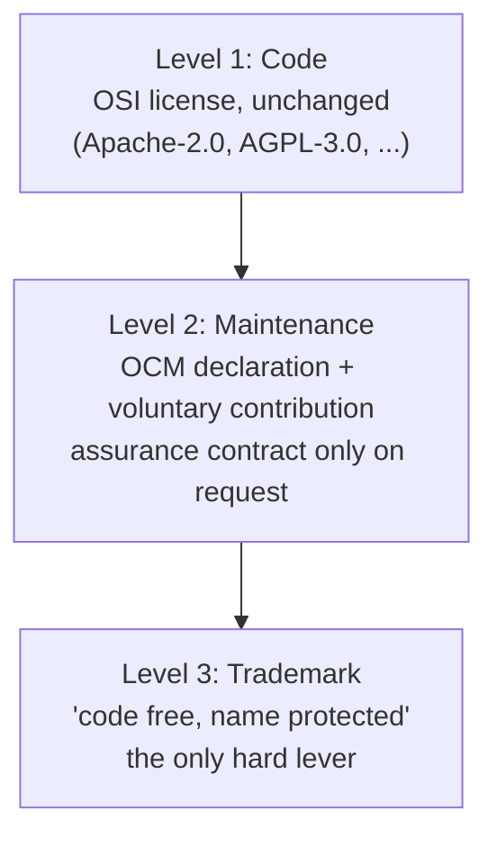

# Open Commons Maintenance (OCM)

> **TL;DR:** OCM is **not a license**. Your code keeps its OSI license (Apache-2.0, MIT, MPL, AGPL, ...). OCM is a public maintenance declaration (`MAINTENANCE.md`) plus a voluntary, usage-based contribution model that counts humans and AI agents in one fair unit. Copy one file, fill in your numbers, done.

Open source is free. Maintenance is not. **Open Commons Maintenance (OCM)** is a model for how software stays under a regular open-source license while its ongoing maintenance is still funded fairly: the same software for everyone, voluntary contributions based on actual use, measured in **Active Usage Equivalents** that treat humans and AI agents alike.

## Why not a license model?

Many projects try to solve funding through a license of their own (open core, BSL/FSL, paywalls). That fails for the same four reasons, every time:

1. Non-OSI licenses read as "source available", not as open source.
2. Self-written licenses are unreviewed legal territory.
3. Licenses cannot enforce payment without destroying "open source".
4. Paywalls create exactly the two-class society they set out to avoid.

OCM flips it around: **the license stays untouched. What gets paid for is maintenance, never access.**

## Active Usage Equivalents: humans and AI agents in one unit

Usage is shifting from humans to agents, CI pipelines, and integrations. A model that only counts users misses tomorrow's usage. OCM counts the accessor, not the request:

- A **human account** active on at least 3 days in a month counts as 1 Active Usage Equivalent (AUE).
- An **agent or integration credential** (API key, token, client ID) active on at least 3 days in a month also counts as 1 AUE.
- **Fair-use band:** installations above 100,000 API requests per month count as at least 3 AUE, above 1,000,000 as at least 10 AUE. No single request is ever billed.
- **Dormant rule:** at most 12 active days per year cost nothing.

Everything is measured locally. For billing, only an aggregated tier ever leaves the server, and only on request.

## Suggested contribution, not a price

Because open source cannot enforce payment (and OCM says so honestly), the tariff classes are **suggested contribution levels by self-assessment**, not purchase contracts. Every class gets the same software, the same releases, the same channels:

| Class | Who | Share of the reference amount |
| --- | --- | --- |
| Free | Anyone who cannot or does not want to pay | 0 % |
| Community | Individuals, families, clubs, schools, research | ~25 % |
| Start | Solo self-employed, micro businesses | ~55 % |
| Reference | All other commercial users, incl. AI platforms | 100 % |

Real prices only exist for real individual services: assurance contracts (SLA, LTS, response times, audits).

## Four guarantees

1. **No feature gate, ever.** Everything that exists is available to everyone.
2. **No rug-pull.** Never moving to a non-OSI license; contributions via DCO, without copyright transfer.
3. **No lockout on non-payment.** No license keys, no phone-home, no degradation.
4. **No data exfiltration for billing.** Only the tier, only on request, with two values.

## Transparency with a sense of proportion

Accountability about the **work delivered**, not the bank balance: an annual maintenance report (releases, fixed vulnerabilities, response times), the funding level as a band (<50 % / 50–99 % / ≥100 %), and the guiding commitment that at least 70 % of contributions flow into maintenance and development, including fair maintainer compensation. Salaries, customers, and revenue stay private.

## Maturity: as much OCM as you want

| Stage | What | Effort |
| --- | --- | --- |
| 0 · Pledge | Declaration + transparent budget need, donations via GitHub Sponsors | hours |
| 1 · Contribution | Tier/class suggestions, payment route for organizations, annual short report | a weekend |
| 2 · Assurance | Individual contracts (SLA, LTS), business registration, merchant of record if needed | on demand |
| 3 · Standard | Modular toolkit/generator, once many projects join | later |

## For SaaS operators: the Hosted module

Anyone offering their software as a SaaS can stay OCM-fair: pricing from two public components (honestly passed-through operating costs, e.g. storage per GB, plus the tier's maintenance contribution), pay-as-you-go with a public monthly cap, a free quota instead of the dormant rule, plan differences in quantities only, never in features, and always: data export and self-hosting as the way out. An OCM SaaS is a convenience, not a prison.

## Adopting OCM in 4 steps

1. Copy `declaration/MAINTENANCE.tmpl.md` into your repository as `MAINTENANCE.md`.
2. Fill in the placeholders (project name, tier prices, payment route, contact).
3. Copy `declaration/ocm.schema.yml` as `ocm.yml` and fill it in (machine-readable).
4. Link `MAINTENANCE.md` in your README and add your payment routes (e.g. `.github/FUNDING.yml`).

Your `LICENSE` stays exactly what it is. You only add.

## Legal notes

- The texts of this guide are under **CC BY 4.0**, code examples under **MIT**. You may adopt and adapt both.
- This repository proposes a model; it is **not legal advice**. Have contract templates reviewed by a professional before real use.
- The label "Open Commons Maintenance" may only be used by projects that keep the mandatory core (OSI license, four guarantees, free class, dormant rule, T1/T2 transparency). Details: `trademark-policy.md`.

## Contact

Idea and pilot: **Jerome Winkel** ([@Jersyfi](https://github.com/Jersyfi)), first applied in [Hubtask](https://github.com/Jersyfi/hubtask). Questions, critique, and adoptions via issues or discussions are welcome.
